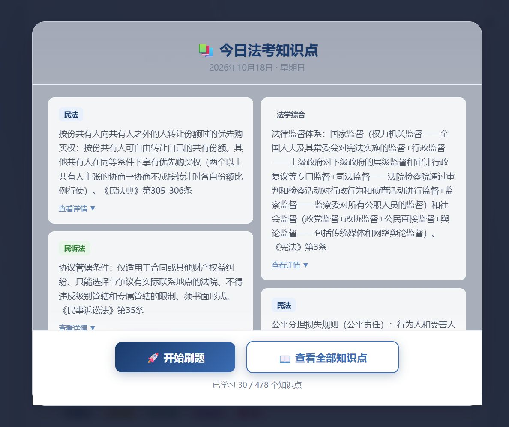

<h1 align="center">📚 法考刷题助手</h1>

民法 · 刑法 · 行政法 · 宪法 …… 陪你稳过法考

  

  <a href="https://xs06.com/"><b>▶️ 点我直接开始刷题</b></a>

<code>https://xs06.com/</code>

---

## ✨ 功能一览

- 📚 **多科目题库** —— 民法 / 刑法 / 行政法 / 民诉 / 刑诉 / 商经 / 法理 / 宪法 / 法制史 / 国际法 / 知识产权法 / 司法制度与职业道德
- 📝 **每日知识点** —— 打开即看「今日法考知识点」，看完一键开始刷题
- 🧠 **智能复习** —— 基于遗忘曲线的间隔重复（SM-2），到点自动提醒该复习哪些题
- 🎯 **模拟考试** —— 限时模拟、自动判分，错题自动进入错题本
- 🔄 **错题本** —— 错题重做模式，答对自动移出；支持收藏重点题
- ☁️ **跨设备同步** —— 同步码 / 文件两种方式，手机、平板进度互通
- 📤 **数据导出** —— 学习数据 JSON、错题 CSV 一键导出
- 📴 **离线可用** —— PWA 缓存，断网也能刷；可添加到主屏幕当 App 用

## 🖼 界面预览

  

## 📱 添加到主屏幕（推荐）

| 设备 | 操作方法 |
| --- | --- |
| iPad / iPhone | Safari 打开 → 分享 → **添加到主屏幕** |
| 华为 / 安卓 | 浏览器打开 → 菜单 → **添加到桌面** |
| 电脑 | Chrome / Edge 地址栏右侧 **安装** 按钮 |

从桌面图标打开即可全屏使用（含开屏动效 🎬），更新自动到达，无需重装。

---

纯前端单页应用（无后端），题库与学习记录均保存在设备本地 · 仅供学习参考
