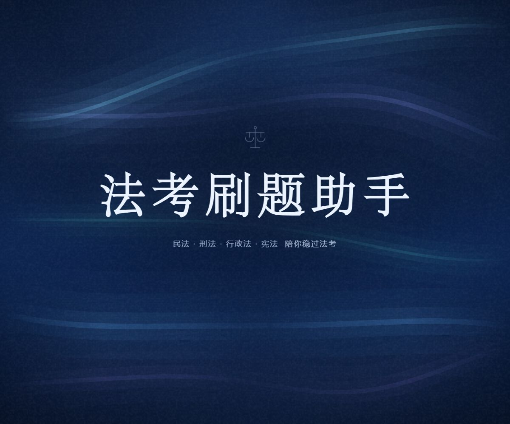
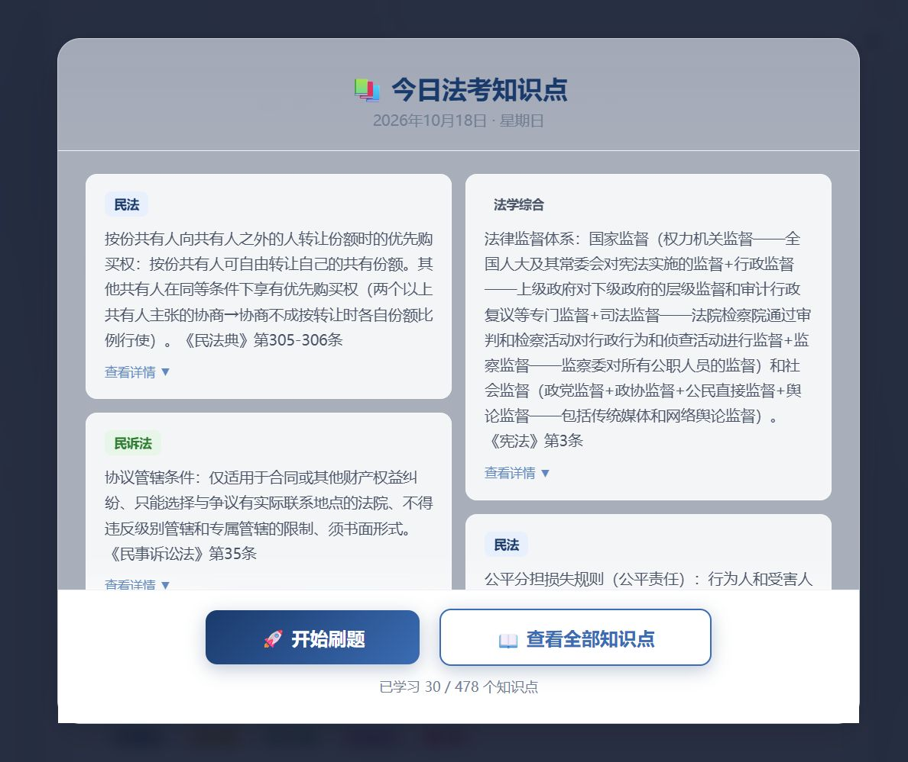

<h1 align="center">📚 法考智练</h1>

民法 · 刑法 · 行政法 · 宪法 …… 陪你稳过法考

  

  <a href="https://xs06.de5.net/"><b>▶️ 点我直接开始刷题</b></a>

<code>https://xs06.de5.net/</code>

---

## ✨ 功能一览

- 📚 **多科目题库** —— 民法 / 刑法 / 行政法 / 民诉 / 刑诉 / 商经 / 法理 / 宪法 / 法制史 / 国际法 / 知识产权法 / 司法制度与职业道德
- 📝 **每日知识点** —— 打开即看「今日法考知识点」，看完一键开始刷题
- 🧠 **智能复习** —— 按「连续答对次数」安排间隔复习：连续答对 1 / 2 / 3 / 4 / 5 次及以上，分别隔 1 / 3 / 7 / 14 / 30 天再出现；答错则连续次数清零、立即回到待复习；主观题提交后 1 天复习
- 🎯 **模拟考试** —— 限时模拟、自动判分，错题自动进入错题本
- 🔄 **错题本** —— 错题重做模式，答对自动移出；支持收藏重点题
- ☁️ **跨设备同步** —— GitHub Gist 云同步 / JSON 文件备份两种方式，手机、平板进度互通
- 📤 **数据导出** —— 学习数据 JSON、错题 CSV 一键导出
- 📴 **离线可用** —— PWA 缓存，断网也能刷；可添加到主屏幕当 App 用

## 🖼 界面预览

  

## 📱 添加到主屏幕（推荐）

| 设备 | 操作方法 |
| --- | --- |
| iPad / iPhone | Safari 打开 → 分享 → **添加到主屏幕** |
| 华为 / 安卓 | 浏览器打开 → 菜单 → **添加到桌面** |
| 电脑 | Chrome / Edge 地址栏右侧 **安装** 按钮 |

从桌面图标打开即可全屏使用（含开屏动效 🎬），更新自动到达，无需重装。

## 🗓 更新日志

- **2026-11-20** — 错题本新增「导出 CSV」：导出序号、科目、题干、我的答案、正确答案、是否已掌握、最近一次作答时间、作答次数；UTF-8 带 BOM，Excel 打开中文不乱码；逗号、引号、换行按 CSV 规范转义；文件名为 `错题本_YYYYMMDD.csv`；无错题时按钮禁用并提示「暂无错题」。
- **2026-11-20** — 新增 `scripts/validate-questions.mjs` 题库完整性校验：检查必填字段、题号为正整数且全局唯一、选择题选项数量与答案指向、题干/解析非空、答案数与题型一致、AI 解析四字段全空，输出科目题数、错误分组和前 20 条明细，有错误时退出码为 1。
- **2026-11-27** — 全量审计 9680 题 + 按 2025 新《反不正当竞争法》逐题重写 57 题解析（Gemini）、补齐 56 题 AI 三段解析；详见下方「题库审计与 2025 更正记录」。

---

## 🧪 题库审计与《反不正当竞争法》2025 更正记录（2026-11-27）

**审计范围**：全库 9680 题（12 科目）、`knowledge.json` 605 条、`case_library.json` 48 条。

**结构完整性结论**：12 科题数与 `questions/index.json` 全部一致；重复 id 0；答案/选项/题型/难度/年份错误 0；空文本/占位符 0；缺失 `analysis_ai` 56 题（已补）。主观题 12 道无选项属正常。

**更正内容**
- 依据 **2025-10-15 施行的《中华人民共和国反不正当竞争法》**（条号整体调整：混淆 §7、商业贿赂 §8、虚假宣传 §9、侵犯商业秘密 §10、有奖销售 §11、商业诋毁 §12、网络 §13、民事责任/赔偿 §22、混淆处罚 §23、虚假处罚 §25、网络处罚 §29、商业秘密举证 §39；一般条款 §2、监督检查 §5 不变），**用 Gemini（Antigravity Hydrogen）分 7 批逐题重写 57 题的解析正文 + 三段解析**（商经法 44 / 知识产权法 6 / 民法 6 / 刑法 1），校验 57/57 齐全、0 旧条号残留。
- 另**补齐其余 56 题**的 `analysis_ai` 三段解析；修正 `knowledge.json` 1 条旧条号（反法 §6→§7）。
- 说明：曾尝试“仅替换条号不改原文”，会产生“字段新号 / 解析原文旧号”不一致，已**回退**，最终以逐题重写为准。

**校验证据**：`total=9680`、`dup=0`、`badAnswer=0`、`badOptions=0`、`missAI=0`；全库反法旧号（6/17/18/19/20/21/32）= 0。
**提交 / 部署**：commit `94e4a51`；线上 `https://xs06.de5.net/` 的 `questions/index.json` 版本 `v2025rewrite-20261127`；抽样 #4909 商业诋毁 §12、#4910 混淆 §7、#4920 虚假 §9、#4958 有奖 §11 均为 2025 新条号。

**后续注意**：**2027-01-01** 起新《商标法》施行（商标异议期 3 个月→2 个月、驰名跨类拟放开“已注册”限制、惩罚性“恶意”拟改“故意”），届时需再更新商标相关题目。

**复核脚本**（本地 `C:\Users\Krilenxs\hdc\`）：`fakao_audit.js`（全量审计）、`rewrite_map.json`（57 题 Gemini 重写结果）、`run_batches.ps1`（Gemini 分批重写）。

---

纯前端单页应用 + Cloudflare Pages Functions 轻后端（AI 解析 / 主观题批改 / 题库抓取走服务端，密钥仅在服务端）；题库与学习记录保存在设备本地 · 仅供学习参考
